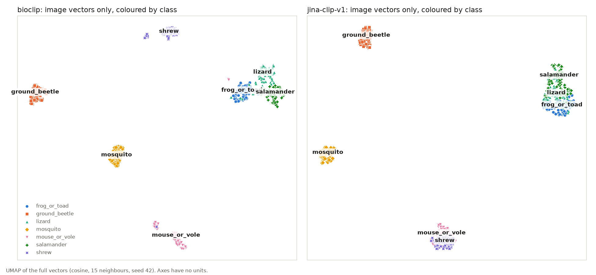
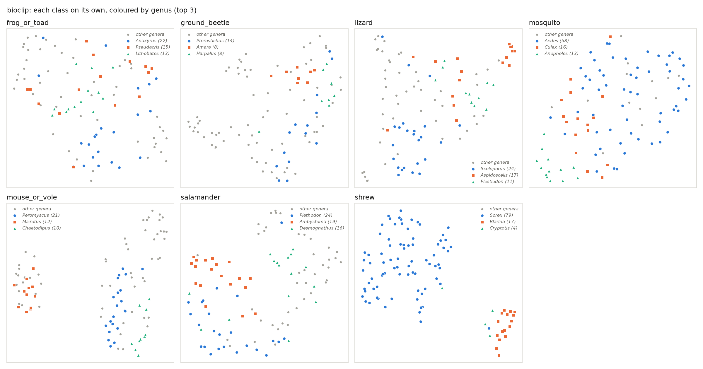
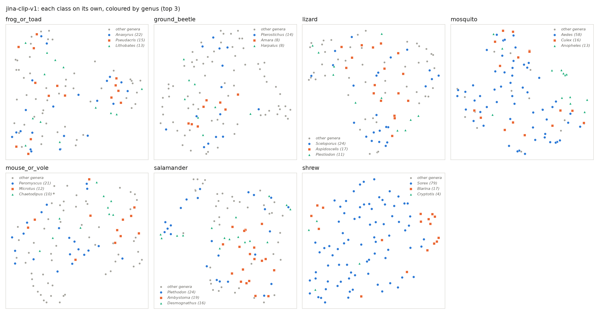

# Clustering the image vectors

Models: bioclip, jina-clip-v1. 700 NEON photos, 7 classes, centre-crop. No text is used.

## Clusters vs classes

ARI and NMI: 0 is random, 1 is a perfect match.

| | bioclip | jina-clip-v1 |
|---|---|---|
| k-means k=7, ARI (10 seeds) | 0.839 ± 0.062 | 0.614 ± 0.004 |
| k-means k=7, NMI | 0.883 ± 0.041 | 0.736 ± 0.004 |
| Agglomerative, ARI / NMI | 0.533 / 0.766 | 0.543 / 0.771 |
| Agglomerative, cluster sizes | 275, 200, 100, 85, 18, 15, 7 | 288, 195, 100, 100, 10, 5, 2 |
| HDBSCAN, clusters found | 4 | 4 |
| HDBSCAN, left as noise | 1.3% | 8.4% |
| HDBSCAN, ARI / NMI (clustered photos) | 0.549 / 0.794 | 0.563 / 0.798 |

k-means (seed 0) for bioclip: rows are clusters, columns are classes.

| cluster | frog_or_toad | ground_beetle | lizard | mosquito | mouse_or_vole | salamander | shrew |
|---|---|---|---|---|---|---|---|
| 1 | 100 | 0 | 23 | 0 | 2 | 5 | 0 |
| 2 | 0 | 0 | 13 | 0 | 0 | 95 | 0 |
| 3 | 0 | 0 | 0 | 0 | 2 | 0 | 100 |
| 4 | 0 | 0 | 0 | 100 | 0 | 0 | 0 |
| 5 | 0 | 100 | 0 | 0 | 0 | 0 | 0 |
| 6 | 0 | 0 | 0 | 0 | 96 | 0 | 0 |
| 7 | 0 | 0 | 64 | 0 | 0 | 0 | 0 |

k-means (seed 0) for jina-clip-v1: rows are clusters, columns are classes.

| cluster | frog_or_toad | ground_beetle | lizard | mosquito | mouse_or_vole | salamander | shrew |
|---|---|---|---|---|---|---|---|
| 1 | 0 | 0 | 0 | 0 | 99 | 0 | 100 |
| 2 | 0 | 0 | 0 | 100 | 0 | 0 | 0 |
| 3 | 0 | 100 | 0 | 0 | 0 | 0 | 0 |
| 4 | 0 | 0 | 27 | 0 | 0 | 68 | 0 |
| 5 | 30 | 0 | 33 | 0 | 0 | 13 | 0 |
| 6 | 18 | 0 | 27 | 0 | 1 | 19 | 0 |
| 7 | 52 | 0 | 13 | 0 | 0 | 0 | 0 |

## Neighbours

| | bioclip | jina-clip-v1 |
|---|---|---|
| Silhouette by class (−1 to 1) | 0.260 | 0.207 |
| Leave-one-out 1-NN, macro accuracy | 97.9% | 85.6% |
| Leave-one-out 5-NN, macro accuracy | 97.7% | 88.4% |
| 1 labelled per class, nearest centre | 80.9% ± 3.3 | 66.3% ± 3.5 |
| 5 labelled per class, nearest centre | 91.5% ± 2.1 | 77.1% ± 2.7 |
| 10 labelled per class, nearest centre | 93.3% ± 1.6 | 80.8% ± 3.4 |
| Zero-shot, best setting (from 08) | 86.9% | 66.1% |
| 1-NN: shrews called mouse or vole | 1 | 7 |
| 1-NN: mice or voles called shrew | 0 | 35 |
| Most similar class centres | mouse_or_vole / shrew | mouse_or_vole / shrew |
| Shrew / mouse-or-vole rank of 21 pairs | 1 | 1 |

## Below class level

Only genera with 5+ photos. NMI baseline: genus labels shuffled 20 times.

| Class | Genera kept | Photos kept | Model | k-means NMI (shuffled) | 1-NN genus accuracy (chance) |
|---|---|---|---|---|---|
| frog_or_toad | *Acris* 10, *Anaxyrus* 22, *Gastrophryne* 5, *Lithobates* 13, *Pseudacris* 15, *Scaphiopus* 7, *Spea* 9 | 81/100 | bioclip | 0.369 (0.141) | 43.4% (14.3%) |
| frog_or_toad | *Acris* 10, *Anaxyrus* 22, *Gastrophryne* 5, *Lithobates* 13, *Pseudacris* 15, *Scaphiopus* 7, *Spea* 9 | 81/100 | jina-clip-v1 | 0.162 (0.145) | 31.0% (14.3%) |
| ground_beetle | *Agonum* 5, *Amara* 8, *Chlaenius* 5, *Harpalus* 8, *Pterostichus* 14 | 40/100 | bioclip | 0.532 (0.161) | 78.6% (20.0%) |
| ground_beetle | *Agonum* 5, *Amara* 8, *Chlaenius* 5, *Harpalus* 8, *Pterostichus* 14 | 40/100 | jina-clip-v1 | 0.314 (0.140) | 59.3% (20.0%) |
| lizard | *Ameiva* 6, *Anolis* 8, *Aspidoscelis* 17, *Holbrookia* 10, *Phrynosoma* 7, *Plestiodon* 11, *Sceloporus* 24, *Sphaerodactylus* 5 | 88/100 | bioclip | 0.515 (0.164) | 68.8% (12.5%) |
| lizard | *Ameiva* 6, *Anolis* 8, *Aspidoscelis* 17, *Holbrookia* 10, *Phrynosoma* 7, *Plestiodon* 11, *Sceloporus* 24, *Sphaerodactylus* 5 | 88/100 | jina-clip-v1 | 0.333 (0.173) | 44.7% (12.5%) |
| mosquito | *Aedes* 58, *Anopheles* 13, *Culex* 16, *Psorophora* 11 | 98/100 | bioclip | 0.298 (0.037) | 51.5% (25.0%) |
| mosquito | *Aedes* 58, *Anopheles* 13, *Culex* 16, *Psorophora* 11 | 98/100 | jina-clip-v1 | 0.093 (0.044) | 55.9% (25.0%) |
| mouse_or_vole | *Chaetodipus* 10, *Dipodomys* 7, *Microtus* 12, *Perognathus* 6, *Peromyscus* 21, *Reithrodontomys* 5, *Zapus* 9 | 70/100 | bioclip | 0.789 (0.155) | 75.1% (14.3%) |
| mouse_or_vole | *Chaetodipus* 10, *Dipodomys* 7, *Microtus* 12, *Perognathus* 6, *Peromyscus* 21, *Reithrodontomys* 5, *Zapus* 9 | 70/100 | jina-clip-v1 | 0.286 (0.158) | 44.0% (14.3%) |
| salamander | *Ambystoma* 19, *Desmognathus* 16, *Ensatina* 9, *Eurycea* 11, *Notophthalmus* 8, *Plethodon* 24 | 87/100 | bioclip | 0.435 (0.098) | 69.5% (16.7%) |
| salamander | *Ambystoma* 19, *Desmognathus* 16, *Ensatina* 9, *Eurycea* 11, *Notophthalmus* 8, *Plethodon* 24 | 87/100 | jina-clip-v1 | 0.257 (0.102) | 48.4% (16.7%) |
| shrew | *Blarina* 17, *Sorex* 79 | 96/100 | bioclip | 0.774 (0.005) | 98.7% (50.0%) |
| shrew | *Blarina* 17, *Sorex* 79 | 96/100 | jina-clip-v1 | 0.260 (0.011) | 83.4% (50.0%) |

## Photo setup

Within one class, how often the nearest photo shares the photographer or view, against chance.

| Group / field | Photos | Values | Model | Same as nearest | Chance |
|---|---|---|---|---|---|
| frog_or_toad / creator | 25 | 4 | bioclip | 60.0% | 27.0% |
| frog_or_toad / creator | 25 | 4 | jina-clip-v1 | 76.0% | 27.0% |
| lizard / creator | 24 | 5 | bioclip | 62.5% | 29.0% |
| lizard / creator | 24 | 5 | jina-clip-v1 | 62.5% | 29.0% |
| mouse_or_vole / creator | 100 | 4 | bioclip | 53.0% | 32.3% |
| mouse_or_vole / creator | 100 | 4 | jina-clip-v1 | 64.0% | 32.3% |
| salamander / creator | 25 | 3 | bioclip | 60.0% | 40.7% |
| salamander / creator | 25 | 3 | jina-clip-v1 | 72.0% | 40.7% |
| shrew / creator | 99 | 7 | bioclip | 70.7% | 33.2% |
| shrew / creator | 99 | 7 | jina-clip-v1 | 65.7% | 33.2% |
| mosquito / view | 100 | 2 | bioclip | 97.0% | 86.8% |
| mosquito / view | 100 | 2 | jina-clip-v1 | 97.0% | 86.8% |
| *Peromyscus* / creator | 21 | 3 | bioclip | 38.1% | 31.9% |
| *Peromyscus* / creator | 21 | 3 | jina-clip-v1 | 42.9% | 31.9% |
| *Sorex* / creator | 78 | 5 | bioclip | 70.5% | 35.6% |
| *Sorex* / creator | 78 | 5 | jina-clip-v1 | 66.7% | 35.6% |

Rows in italics are inside one genus, which removes genus as the reason.

| | bioclip | jina-clip-v1 |
|---|---|---|
| NMI, class vs photographer | 0.445 | 0.445 |
| NMI, k-means clusters vs photographer | 0.441 | 0.457 |

Image size is 512×341 for 699 of 700 photos, so it is not tested.

## Misfits

Photos whose 5 nearest neighbours all belong to another class.

**bioclip:** 1 photos.

| Photo | Class | Genus | Neighbours are |
|---|---|---|---|
| `images/lizard/NEON06J6Q_1.jpg` | lizard | *Plestiodon* | salamander |

**jina-clip-v1:** 8 photos.

| Photo | Class | Genus | Neighbours are |
|---|---|---|---|
| `images/mouse_or_vole/NEON0D8OA_1.jpg` | mouse_or_vole | *Mictomys* | shrew |
| `images/frog_or_toad/NEON02C0S_1.jpg` | frog_or_toad | *Pseudacris* | lizard |
| `images/salamander/NEON06J6K_1.jpg` | salamander | *Eurycea* | lizard |
| `images/salamander/NEON00XTV_1.jpg` | salamander | *Batrachoseps* | lizard |
| `images/salamander/NEON02H3B_1.jpg` | salamander | *Ensatina* | lizard |
| `images/salamander/NEON069S6_1.jpg` | salamander | *Plethodon* | frog_or_toad |
| `images/lizard/NEON02H42_1.jpg` | lizard | *Scincella* | salamander |
| `images/lizard/NEON00XQC_1.jpg` | lizard | *Scincella* | salamander |

## Plots

