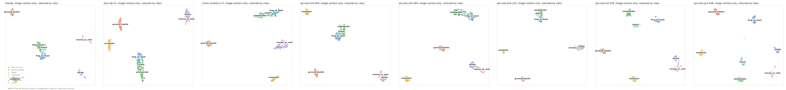
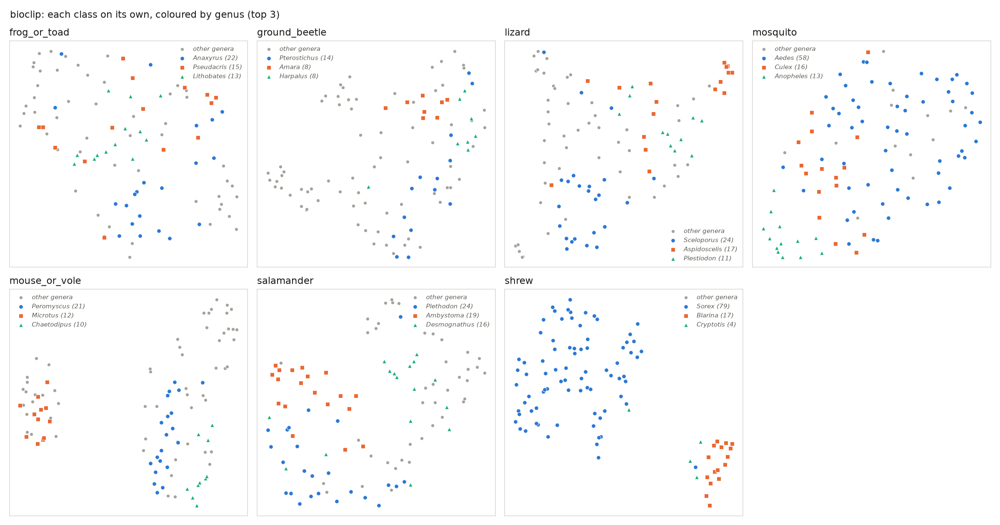
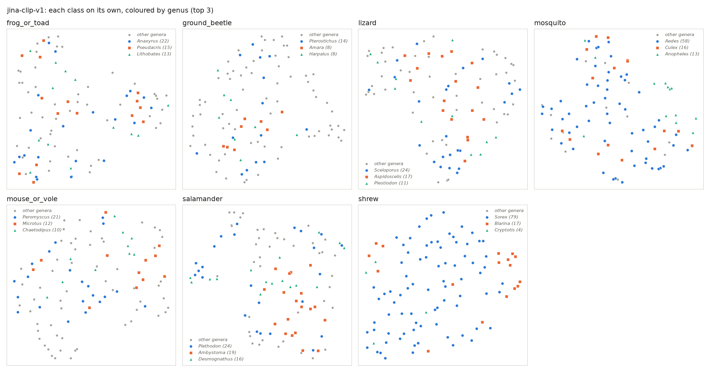
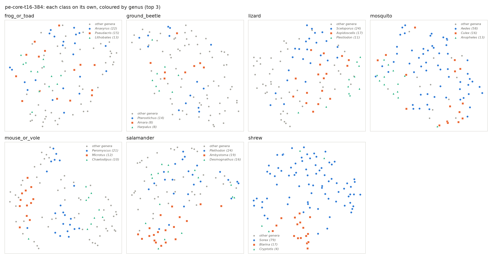
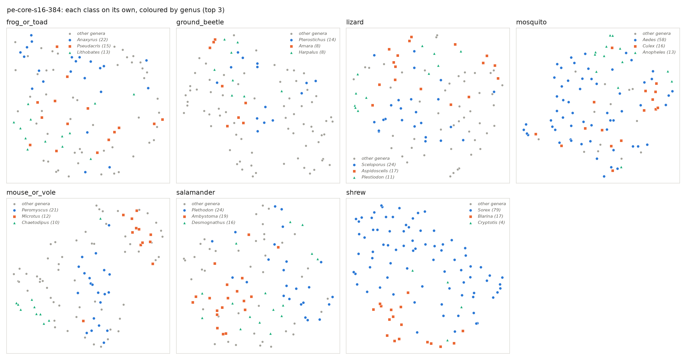
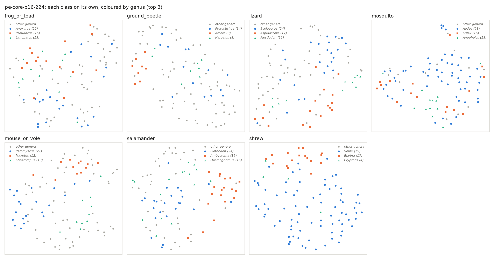
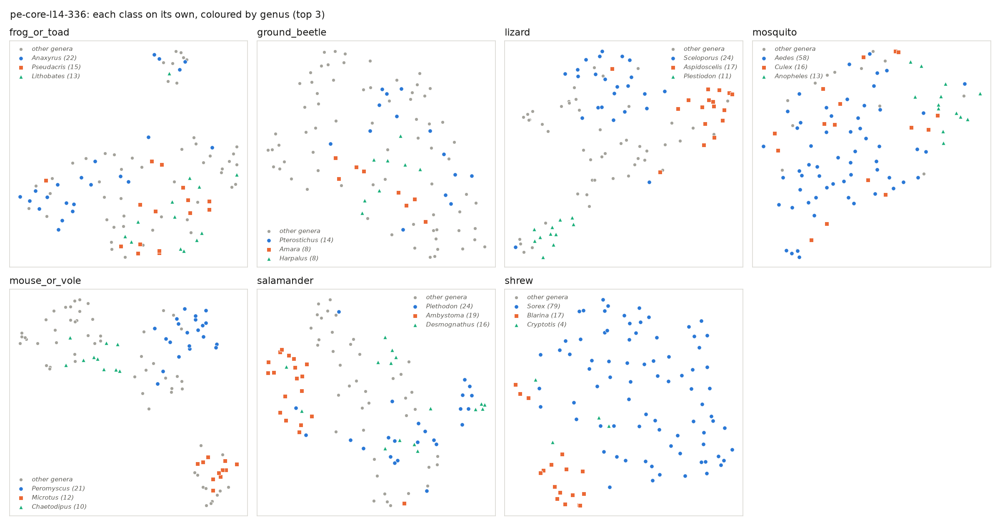
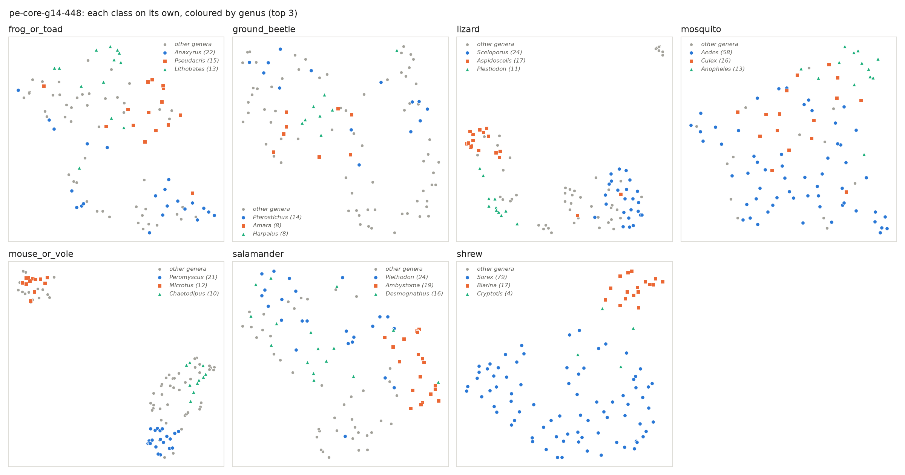

# Clustering the image vectors

Models: bioclip, jina-clip-v1, nomic-embed-v1.5, pe-core-t16-384, pe-core-s16-384, pe-core-b16-224, pe-core-l14-336, pe-core-g14-448. 700 NEON photos, 7 classes, centre-crop. No text is used.

## Clusters vs classes

ARI and NMI: 0 is random, 1 is a perfect match.

| | bioclip | jina-clip-v1 | nomic-embed-v1.5 | pe-core-t16-384 | pe-core-s16-384 | pe-core-b16-224 | pe-core-l14-336 | pe-core-g14-448 |
|---|---|---|---|---|---|---|---|---|
| k-means k=7, ARI (10 seeds) | 0.839 ± 0.062 | 0.614 ± 0.004 | 0.685 ± 0.007 | 0.694 ± 0.013 | 0.749 ± 0.020 | 0.747 ± 0.025 | 0.929 ± 0.000 | 0.946 ± 0.022 |
| k-means k=7, NMI | 0.883 ± 0.041 | 0.736 ± 0.004 | 0.777 ± 0.003 | 0.790 ± 0.006 | 0.829 ± 0.010 | 0.817 ± 0.009 | 0.946 ± 0.000 | 0.954 ± 0.014 |
| Agglomerative, ARI / NMI | 0.533 / 0.766 | 0.543 / 0.771 | 0.207 / 0.468 | 0.542 / 0.784 | 0.540 / 0.777 | 0.545 / 0.781 | 0.545 / 0.784 | 0.725 / 0.876 |
| Agglomerative, cluster sizes | 275, 200, 100, 85, 18, 15, 7 | 288, 195, 100, 100, 10, 5, 2 | 482, 199, 11, 3, 2, 2, 1 | 298, 196, 100, 99, 4, 2, 1 | 298, 193, 100, 99, 7, 2, 1 | 293, 197, 100, 100, 5, 3, 2 | 294, 197, 100, 100, 5, 3, 1 | 197, 193, 100, 100, 100, 7, 3 |
| HDBSCAN, clusters found | 4 | 4 | 4 | 3 | 4 | 4 | 4 | 4 |
| HDBSCAN, left as noise | 1.3% | 8.4% | 9.7% | 2.4% | 3.1% | 1.7% | 0.7% | 0.3% |
| HDBSCAN, ARI / NMI (clustered photos) | 0.549 / 0.794 | 0.563 / 0.798 | 0.580 / 0.803 | 0.223 / 0.568 | 0.545 / 0.792 | 0.542 / 0.787 | 0.547 / 0.793 | 0.546 / 0.792 |

k-means (seed 0) for bioclip: rows are clusters, columns are classes.

| cluster | frog_or_toad | ground_beetle | lizard | mosquito | mouse_or_vole | salamander | shrew |
|---|---|---|---|---|---|---|---|
| 1 | 100 | 0 | 23 | 0 | 2 | 5 | 0 |
| 2 | 0 | 0 | 13 | 0 | 0 | 95 | 0 |
| 3 | 0 | 0 | 0 | 0 | 2 | 0 | 100 |
| 4 | 0 | 0 | 0 | 100 | 0 | 0 | 0 |
| 5 | 0 | 100 | 0 | 0 | 0 | 0 | 0 |
| 6 | 0 | 0 | 0 | 0 | 96 | 0 | 0 |
| 7 | 0 | 0 | 64 | 0 | 0 | 0 | 0 |

k-means (seed 0) for jina-clip-v1: rows are clusters, columns are classes.

| cluster | frog_or_toad | ground_beetle | lizard | mosquito | mouse_or_vole | salamander | shrew |
|---|---|---|---|---|---|---|---|
| 1 | 0 | 0 | 0 | 0 | 99 | 0 | 100 |
| 2 | 0 | 0 | 0 | 100 | 0 | 0 | 0 |
| 3 | 0 | 100 | 0 | 0 | 0 | 0 | 0 |
| 4 | 0 | 0 | 27 | 0 | 0 | 68 | 0 |
| 5 | 30 | 0 | 33 | 0 | 0 | 13 | 0 |
| 6 | 18 | 0 | 27 | 0 | 1 | 19 | 0 |
| 7 | 52 | 0 | 13 | 0 | 0 | 0 | 0 |

k-means (seed 0) for nomic-embed-v1.5: rows are clusters, columns are classes.

| cluster | frog_or_toad | ground_beetle | lizard | mosquito | mouse_or_vole | salamander | shrew |
|---|---|---|---|---|---|---|---|
| 1 | 0 | 0 | 41 | 0 | 0 | 87 | 0 |
| 2 | 0 | 0 | 0 | 0 | 88 | 0 | 26 |
| 3 | 83 | 0 | 22 | 0 | 0 | 1 | 1 |
| 4 | 0 | 100 | 0 | 0 | 0 | 0 | 0 |
| 5 | 0 | 0 | 0 | 100 | 0 | 0 | 0 |
| 6 | 0 | 0 | 0 | 0 | 9 | 0 | 73 |
| 7 | 17 | 0 | 37 | 0 | 3 | 12 | 0 |

k-means (seed 0) for pe-core-t16-384: rows are clusters, columns are classes.

| cluster | frog_or_toad | ground_beetle | lizard | mosquito | mouse_or_vole | salamander | shrew |
|---|---|---|---|---|---|---|---|
| 1 | 0 | 0 | 0 | 0 | 31 | 0 | 100 |
| 2 | 5 | 0 | 40 | 0 | 0 | 79 | 0 |
| 3 | 86 | 0 | 15 | 0 | 0 | 3 | 0 |
| 4 | 0 | 0 | 0 | 100 | 0 | 0 | 0 |
| 5 | 0 | 100 | 0 | 0 | 0 | 0 | 0 |
| 6 | 9 | 0 | 45 | 0 | 0 | 18 | 0 |
| 7 | 0 | 0 | 0 | 0 | 69 | 0 | 0 |

k-means (seed 0) for pe-core-s16-384: rows are clusters, columns are classes.

| cluster | frog_or_toad | ground_beetle | lizard | mosquito | mouse_or_vole | salamander | shrew |
|---|---|---|---|---|---|---|---|
| 1 | 0 | 0 | 39 | 0 | 0 | 90 | 0 |
| 2 | 0 | 0 | 0 | 0 | 24 | 0 | 100 |
| 3 | 95 | 0 | 9 | 0 | 0 | 1 | 0 |
| 4 | 0 | 100 | 0 | 0 | 0 | 0 | 0 |
| 5 | 0 | 0 | 0 | 100 | 0 | 0 | 0 |
| 6 | 0 | 0 | 0 | 0 | 76 | 0 | 0 |
| 7 | 5 | 0 | 52 | 0 | 0 | 9 | 0 |

k-means (seed 0) for pe-core-b16-224: rows are clusters, columns are classes.

| cluster | frog_or_toad | ground_beetle | lizard | mosquito | mouse_or_vole | salamander | shrew |
|---|---|---|---|---|---|---|---|
| 1 | 0 | 0 | 49 | 0 | 0 | 87 | 0 |
| 2 | 0 | 0 | 0 | 0 | 6 | 0 | 96 |
| 3 | 0 | 100 | 0 | 1 | 0 | 0 | 0 |
| 4 | 88 | 0 | 10 | 0 | 0 | 1 | 0 |
| 5 | 0 | 0 | 0 | 98 | 0 | 0 | 0 |
| 6 | 0 | 0 | 0 | 0 | 93 | 0 | 4 |
| 7 | 12 | 0 | 41 | 1 | 1 | 12 | 0 |

k-means (seed 0) for pe-core-l14-336: rows are clusters, columns are classes.

| cluster | frog_or_toad | ground_beetle | lizard | mosquito | mouse_or_vole | salamander | shrew |
|---|---|---|---|---|---|---|---|
| 1 | 0 | 0 | 18 | 0 | 0 | 100 | 0 |
| 2 | 0 | 0 | 0 | 0 | 99 | 0 | 3 |
| 3 | 100 | 0 | 1 | 0 | 0 | 0 | 0 |
| 4 | 0 | 100 | 0 | 0 | 0 | 0 | 0 |
| 5 | 0 | 0 | 0 | 100 | 0 | 0 | 0 |
| 6 | 0 | 0 | 0 | 0 | 1 | 0 | 97 |
| 7 | 0 | 0 | 81 | 0 | 0 | 0 | 0 |

k-means (seed 0) for pe-core-g14-448: rows are clusters, columns are classes.

| cluster | frog_or_toad | ground_beetle | lizard | mosquito | mouse_or_vole | salamander | shrew |
|---|---|---|---|---|---|---|---|
| 1 | 100 | 0 | 6 | 0 | 0 | 0 | 0 |
| 2 | 0 | 0 | 6 | 0 | 0 | 100 | 0 |
| 3 | 0 | 0 | 0 | 0 | 100 | 0 | 1 |
| 4 | 0 | 100 | 0 | 0 | 0 | 0 | 0 |
| 5 | 0 | 0 | 0 | 100 | 0 | 0 | 0 |
| 6 | 0 | 0 | 0 | 0 | 0 | 0 | 99 |
| 7 | 0 | 0 | 88 | 0 | 0 | 0 | 0 |

## Neighbours

| | bioclip | jina-clip-v1 | nomic-embed-v1.5 | pe-core-t16-384 | pe-core-s16-384 | pe-core-b16-224 | pe-core-l14-336 | pe-core-g14-448 |
|---|---|---|---|---|---|---|---|---|
| Silhouette by class (−1 to 1) | 0.260 | 0.207 | 0.309 | 0.218 | 0.271 | 0.297 | 0.447 | 0.512 |
| Leave-one-out 1-NN, macro accuracy | 97.9% | 85.6% | 90.3% | 92.0% | 94.3% | 95.4% | 99.1% | 99.1% |
| Leave-one-out 5-NN, macro accuracy | 97.7% | 88.4% | 91.3% | 92.1% | 95.9% | 95.9% | 98.1% | 99.4% |
| 1 labelled per class, nearest centre | 80.9% ± 3.3 | 66.3% ± 3.5 | 73.5% ± 3.4 | 71.3% ± 2.9 | 76.9% ± 3.9 | 78.8% ± 5.0 | 88.1% ± 4.8 | 93.1% ± 3.4 |
| 5 labelled per class, nearest centre | 91.5% ± 2.1 | 77.1% ± 2.7 | 84.0% ± 2.4 | 83.8% ± 1.8 | 87.0% ± 2.3 | 88.8% ± 2.5 | 95.3% ± 1.1 | 97.4% ± 1.3 |
| 10 labelled per class, nearest centre | 93.3% ± 1.6 | 80.8% ± 3.4 | 85.6% ± 2.0 | 87.9% ± 2.0 | 89.9% ± 1.7 | 90.4% ± 2.8 | 96.2% ± 1.0 | 97.9% ± 1.0 |
| Zero-shot, best setting (from 08) | 86.9% | 66.1% | 74.0% | 71.0% | 78.9% | 88.7% | 94.6% | 97.4% |
| 1-NN: shrews called mouse or vole | 1 | 7 | 6 | 3 | 2 | 1 | 1 | 0 |
| 1-NN: mice or voles called shrew | 0 | 35 | 5 | 8 | 2 | 1 | 1 | 0 |
| Most similar class centres | mouse_or_vole / shrew | mouse_or_vole / shrew | lizard / salamander | lizard / salamander | lizard / salamander | mouse_or_vole / shrew | mouse_or_vole / shrew | mouse_or_vole / shrew |
| Shrew / mouse-or-vole rank of 21 pairs | 1 | 1 | 2 | 2 | 3 | 1 | 1 | 1 |

## Below class level

Only genera with 5+ photos. NMI baseline: genus labels shuffled 20 times.

| Class | Genera kept | Photos kept | Model | k-means NMI (shuffled) | 1-NN genus accuracy (chance) |
|---|---|---|---|---|---|
| frog_or_toad | *Acris* 10, *Anaxyrus* 22, *Gastrophryne* 5, *Lithobates* 13, *Pseudacris* 15, *Scaphiopus* 7, *Spea* 9 | 81/100 | bioclip | 0.369 (0.141) | 43.4% (14.3%) |
| frog_or_toad | *Acris* 10, *Anaxyrus* 22, *Gastrophryne* 5, *Lithobates* 13, *Pseudacris* 15, *Scaphiopus* 7, *Spea* 9 | 81/100 | jina-clip-v1 | 0.162 (0.145) | 31.0% (14.3%) |
| frog_or_toad | *Acris* 10, *Anaxyrus* 22, *Gastrophryne* 5, *Lithobates* 13, *Pseudacris* 15, *Scaphiopus* 7, *Spea* 9 | 81/100 | nomic-embed-v1.5 | 0.210 (0.131) | 16.6% (14.3%) |
| frog_or_toad | *Acris* 10, *Anaxyrus* 22, *Gastrophryne* 5, *Lithobates* 13, *Pseudacris* 15, *Scaphiopus* 7, *Spea* 9 | 81/100 | pe-core-t16-384 | 0.237 (0.149) | 36.7% (14.3%) |
| frog_or_toad | *Acris* 10, *Anaxyrus* 22, *Gastrophryne* 5, *Lithobates* 13, *Pseudacris* 15, *Scaphiopus* 7, *Spea* 9 | 81/100 | pe-core-s16-384 | 0.332 (0.144) | 39.9% (14.3%) |
| frog_or_toad | *Acris* 10, *Anaxyrus* 22, *Gastrophryne* 5, *Lithobates* 13, *Pseudacris* 15, *Scaphiopus* 7, *Spea* 9 | 81/100 | pe-core-b16-224 | 0.212 (0.127) | 39.8% (14.3%) |
| frog_or_toad | *Acris* 10, *Anaxyrus* 22, *Gastrophryne* 5, *Lithobates* 13, *Pseudacris* 15, *Scaphiopus* 7, *Spea* 9 | 81/100 | pe-core-l14-336 | 0.368 (0.139) | 46.7% (14.3%) |
| frog_or_toad | *Acris* 10, *Anaxyrus* 22, *Gastrophryne* 5, *Lithobates* 13, *Pseudacris* 15, *Scaphiopus* 7, *Spea* 9 | 81/100 | pe-core-g14-448 | 0.425 (0.141) | 50.3% (14.3%) |
| ground_beetle | *Agonum* 5, *Amara* 8, *Chlaenius* 5, *Harpalus* 8, *Pterostichus* 14 | 40/100 | bioclip | 0.532 (0.161) | 78.6% (20.0%) |
| ground_beetle | *Agonum* 5, *Amara* 8, *Chlaenius* 5, *Harpalus* 8, *Pterostichus* 14 | 40/100 | jina-clip-v1 | 0.314 (0.140) | 59.3% (20.0%) |
| ground_beetle | *Agonum* 5, *Amara* 8, *Chlaenius* 5, *Harpalus* 8, *Pterostichus* 14 | 40/100 | nomic-embed-v1.5 | 0.286 (0.160) | 48.4% (20.0%) |
| ground_beetle | *Agonum* 5, *Amara* 8, *Chlaenius* 5, *Harpalus* 8, *Pterostichus* 14 | 40/100 | pe-core-t16-384 | 0.443 (0.166) | 61.3% (20.0%) |
| ground_beetle | *Agonum* 5, *Amara* 8, *Chlaenius* 5, *Harpalus* 8, *Pterostichus* 14 | 40/100 | pe-core-s16-384 | 0.265 (0.150) | 55.3% (20.0%) |
| ground_beetle | *Agonum* 5, *Amara* 8, *Chlaenius* 5, *Harpalus* 8, *Pterostichus* 14 | 40/100 | pe-core-b16-224 | 0.377 (0.150) | 64.2% (20.0%) |
| ground_beetle | *Agonum* 5, *Amara* 8, *Chlaenius* 5, *Harpalus* 8, *Pterostichus* 14 | 40/100 | pe-core-l14-336 | 0.478 (0.170) | 80.1% (20.0%) |
| ground_beetle | *Agonum* 5, *Amara* 8, *Chlaenius* 5, *Harpalus* 8, *Pterostichus* 14 | 40/100 | pe-core-g14-448 | 0.389 (0.150) | 58.8% (20.0%) |
| lizard | *Ameiva* 6, *Anolis* 8, *Aspidoscelis* 17, *Holbrookia* 10, *Phrynosoma* 7, *Plestiodon* 11, *Sceloporus* 24, *Sphaerodactylus* 5 | 88/100 | bioclip | 0.515 (0.164) | 68.8% (12.5%) |
| lizard | *Ameiva* 6, *Anolis* 8, *Aspidoscelis* 17, *Holbrookia* 10, *Phrynosoma* 7, *Plestiodon* 11, *Sceloporus* 24, *Sphaerodactylus* 5 | 88/100 | jina-clip-v1 | 0.333 (0.173) | 44.7% (12.5%) |
| lizard | *Ameiva* 6, *Anolis* 8, *Aspidoscelis* 17, *Holbrookia* 10, *Phrynosoma* 7, *Plestiodon* 11, *Sceloporus* 24, *Sphaerodactylus* 5 | 88/100 | nomic-embed-v1.5 | 0.294 (0.166) | 31.5% (12.5%) |
| lizard | *Ameiva* 6, *Anolis* 8, *Aspidoscelis* 17, *Holbrookia* 10, *Phrynosoma* 7, *Plestiodon* 11, *Sceloporus* 24, *Sphaerodactylus* 5 | 88/100 | pe-core-t16-384 | 0.400 (0.172) | 56.6% (12.5%) |
| lizard | *Ameiva* 6, *Anolis* 8, *Aspidoscelis* 17, *Holbrookia* 10, *Phrynosoma* 7, *Plestiodon* 11, *Sceloporus* 24, *Sphaerodactylus* 5 | 88/100 | pe-core-s16-384 | 0.436 (0.163) | 60.3% (12.5%) |
| lizard | *Ameiva* 6, *Anolis* 8, *Aspidoscelis* 17, *Holbrookia* 10, *Phrynosoma* 7, *Plestiodon* 11, *Sceloporus* 24, *Sphaerodactylus* 5 | 88/100 | pe-core-b16-224 | 0.487 (0.167) | 57.4% (12.5%) |
| lizard | *Ameiva* 6, *Anolis* 8, *Aspidoscelis* 17, *Holbrookia* 10, *Phrynosoma* 7, *Plestiodon* 11, *Sceloporus* 24, *Sphaerodactylus* 5 | 88/100 | pe-core-l14-336 | 0.684 (0.169) | 71.7% (12.5%) |
| lizard | *Ameiva* 6, *Anolis* 8, *Aspidoscelis* 17, *Holbrookia* 10, *Phrynosoma* 7, *Plestiodon* 11, *Sceloporus* 24, *Sphaerodactylus* 5 | 88/100 | pe-core-g14-448 | 0.747 (0.171) | 82.6% (12.5%) |
| mosquito | *Aedes* 58, *Anopheles* 13, *Culex* 16, *Psorophora* 11 | 98/100 | bioclip | 0.298 (0.037) | 51.5% (25.0%) |
| mosquito | *Aedes* 58, *Anopheles* 13, *Culex* 16, *Psorophora* 11 | 98/100 | jina-clip-v1 | 0.093 (0.044) | 55.9% (25.0%) |
| mosquito | *Aedes* 58, *Anopheles* 13, *Culex* 16, *Psorophora* 11 | 98/100 | nomic-embed-v1.5 | 0.029 (0.050) | 43.0% (25.0%) |
| mosquito | *Aedes* 58, *Anopheles* 13, *Culex* 16, *Psorophora* 11 | 98/100 | pe-core-t16-384 | 0.049 (0.048) | 48.1% (25.0%) |
| mosquito | *Aedes* 58, *Anopheles* 13, *Culex* 16, *Psorophora* 11 | 98/100 | pe-core-s16-384 | 0.080 (0.046) | 46.1% (25.0%) |
| mosquito | *Aedes* 58, *Anopheles* 13, *Culex* 16, *Psorophora* 11 | 98/100 | pe-core-b16-224 | 0.052 (0.044) | 36.7% (25.0%) |
| mosquito | *Aedes* 58, *Anopheles* 13, *Culex* 16, *Psorophora* 11 | 98/100 | pe-core-l14-336 | 0.229 (0.042) | 44.1% (25.0%) |
| mosquito | *Aedes* 58, *Anopheles* 13, *Culex* 16, *Psorophora* 11 | 98/100 | pe-core-g14-448 | 0.178 (0.044) | 51.8% (25.0%) |
| mouse_or_vole | *Chaetodipus* 10, *Dipodomys* 7, *Microtus* 12, *Perognathus* 6, *Peromyscus* 21, *Reithrodontomys* 5, *Zapus* 9 | 70/100 | bioclip | 0.789 (0.155) | 75.1% (14.3%) |
| mouse_or_vole | *Chaetodipus* 10, *Dipodomys* 7, *Microtus* 12, *Perognathus* 6, *Peromyscus* 21, *Reithrodontomys* 5, *Zapus* 9 | 70/100 | jina-clip-v1 | 0.286 (0.158) | 44.0% (14.3%) |
| mouse_or_vole | *Chaetodipus* 10, *Dipodomys* 7, *Microtus* 12, *Perognathus* 6, *Peromyscus* 21, *Reithrodontomys* 5, *Zapus* 9 | 70/100 | nomic-embed-v1.5 | 0.423 (0.149) | 56.2% (14.3%) |
| mouse_or_vole | *Chaetodipus* 10, *Dipodomys* 7, *Microtus* 12, *Perognathus* 6, *Peromyscus* 21, *Reithrodontomys* 5, *Zapus* 9 | 70/100 | pe-core-t16-384 | 0.599 (0.161) | 65.8% (14.3%) |
| mouse_or_vole | *Chaetodipus* 10, *Dipodomys* 7, *Microtus* 12, *Perognathus* 6, *Peromyscus* 21, *Reithrodontomys* 5, *Zapus* 9 | 70/100 | pe-core-s16-384 | 0.638 (0.154) | 67.4% (14.3%) |
| mouse_or_vole | *Chaetodipus* 10, *Dipodomys* 7, *Microtus* 12, *Perognathus* 6, *Peromyscus* 21, *Reithrodontomys* 5, *Zapus* 9 | 70/100 | pe-core-b16-224 | 0.601 (0.163) | 72.5% (14.3%) |
| mouse_or_vole | *Chaetodipus* 10, *Dipodomys* 7, *Microtus* 12, *Perognathus* 6, *Peromyscus* 21, *Reithrodontomys* 5, *Zapus* 9 | 70/100 | pe-core-l14-336 | 0.731 (0.160) | 85.3% (14.3%) |
| mouse_or_vole | *Chaetodipus* 10, *Dipodomys* 7, *Microtus* 12, *Perognathus* 6, *Peromyscus* 21, *Reithrodontomys* 5, *Zapus* 9 | 70/100 | pe-core-g14-448 | 0.748 (0.162) | 85.1% (14.3%) |
| salamander | *Ambystoma* 19, *Desmognathus* 16, *Ensatina* 9, *Eurycea* 11, *Notophthalmus* 8, *Plethodon* 24 | 87/100 | bioclip | 0.435 (0.098) | 69.5% (16.7%) |
| salamander | *Ambystoma* 19, *Desmognathus* 16, *Ensatina* 9, *Eurycea* 11, *Notophthalmus* 8, *Plethodon* 24 | 87/100 | jina-clip-v1 | 0.257 (0.102) | 48.4% (16.7%) |
| salamander | *Ambystoma* 19, *Desmognathus* 16, *Ensatina* 9, *Eurycea* 11, *Notophthalmus* 8, *Plethodon* 24 | 87/100 | nomic-embed-v1.5 | 0.229 (0.098) | 54.7% (16.7%) |
| salamander | *Ambystoma* 19, *Desmognathus* 16, *Ensatina* 9, *Eurycea* 11, *Notophthalmus* 8, *Plethodon* 24 | 87/100 | pe-core-t16-384 | 0.266 (0.100) | 50.2% (16.7%) |
| salamander | *Ambystoma* 19, *Desmognathus* 16, *Ensatina* 9, *Eurycea* 11, *Notophthalmus* 8, *Plethodon* 24 | 87/100 | pe-core-s16-384 | 0.272 (0.097) | 46.9% (16.7%) |
| salamander | *Ambystoma* 19, *Desmognathus* 16, *Ensatina* 9, *Eurycea* 11, *Notophthalmus* 8, *Plethodon* 24 | 87/100 | pe-core-b16-224 | 0.300 (0.099) | 66.4% (16.7%) |
| salamander | *Ambystoma* 19, *Desmognathus* 16, *Ensatina* 9, *Eurycea* 11, *Notophthalmus* 8, *Plethodon* 24 | 87/100 | pe-core-l14-336 | 0.413 (0.106) | 68.7% (16.7%) |
| salamander | *Ambystoma* 19, *Desmognathus* 16, *Ensatina* 9, *Eurycea* 11, *Notophthalmus* 8, *Plethodon* 24 | 87/100 | pe-core-g14-448 | 0.447 (0.098) | 71.4% (16.7%) |
| shrew | *Blarina* 17, *Sorex* 79 | 96/100 | bioclip | 0.774 (0.005) | 98.7% (50.0%) |
| shrew | *Blarina* 17, *Sorex* 79 | 96/100 | jina-clip-v1 | 0.260 (0.011) | 83.4% (50.0%) |
| shrew | *Blarina* 17, *Sorex* 79 | 96/100 | nomic-embed-v1.5 | 0.146 (0.010) | 91.2% (50.0%) |
| shrew | *Blarina* 17, *Sorex* 79 | 96/100 | pe-core-t16-384 | 0.380 (0.008) | 98.7% (50.0%) |
| shrew | *Blarina* 17, *Sorex* 79 | 96/100 | pe-core-s16-384 | 0.368 (0.006) | 85.7% (50.0%) |
| shrew | *Blarina* 17, *Sorex* 79 | 96/100 | pe-core-b16-224 | 0.412 (0.007) | 90.5% (50.0%) |
| shrew | *Blarina* 17, *Sorex* 79 | 96/100 | pe-core-l14-336 | 0.412 (0.008) | 97.1% (50.0%) |
| shrew | *Blarina* 17, *Sorex* 79 | 96/100 | pe-core-g14-448 | 0.685 (0.008) | 100.0% (50.0%) |

## Photo setup

Within one class, how often the nearest photo shares the photographer or view, against chance.

| Group / field | Photos | Values | Model | Same as nearest | Chance |
|---|---|---|---|---|---|
| frog_or_toad / creator | 25 | 4 | bioclip | 60.0% | 27.0% |
| frog_or_toad / creator | 25 | 4 | jina-clip-v1 | 76.0% | 27.0% |
| frog_or_toad / creator | 25 | 4 | nomic-embed-v1.5 | 52.0% | 27.0% |
| frog_or_toad / creator | 25 | 4 | pe-core-t16-384 | 68.0% | 27.0% |
| frog_or_toad / creator | 25 | 4 | pe-core-s16-384 | 52.0% | 27.0% |
| frog_or_toad / creator | 25 | 4 | pe-core-b16-224 | 52.0% | 27.0% |
| frog_or_toad / creator | 25 | 4 | pe-core-l14-336 | 60.0% | 27.0% |
| frog_or_toad / creator | 25 | 4 | pe-core-g14-448 | 64.0% | 27.0% |
| lizard / creator | 24 | 5 | bioclip | 62.5% | 29.0% |
| lizard / creator | 24 | 5 | jina-clip-v1 | 62.5% | 29.0% |
| lizard / creator | 24 | 5 | nomic-embed-v1.5 | 58.3% | 29.0% |
| lizard / creator | 24 | 5 | pe-core-t16-384 | 58.3% | 29.0% |
| lizard / creator | 24 | 5 | pe-core-s16-384 | 58.3% | 29.0% |
| lizard / creator | 24 | 5 | pe-core-b16-224 | 54.2% | 29.0% |
| lizard / creator | 24 | 5 | pe-core-l14-336 | 54.2% | 29.0% |
| lizard / creator | 24 | 5 | pe-core-g14-448 | 54.2% | 29.0% |
| mouse_or_vole / creator | 100 | 4 | bioclip | 53.0% | 32.3% |
| mouse_or_vole / creator | 100 | 4 | jina-clip-v1 | 64.0% | 32.3% |
| mouse_or_vole / creator | 100 | 4 | nomic-embed-v1.5 | 55.0% | 32.3% |
| mouse_or_vole / creator | 100 | 4 | pe-core-t16-384 | 63.0% | 32.3% |
| mouse_or_vole / creator | 100 | 4 | pe-core-s16-384 | 66.0% | 32.3% |
| mouse_or_vole / creator | 100 | 4 | pe-core-b16-224 | 57.0% | 32.3% |
| mouse_or_vole / creator | 100 | 4 | pe-core-l14-336 | 59.0% | 32.3% |
| mouse_or_vole / creator | 100 | 4 | pe-core-g14-448 | 50.0% | 32.3% |
| salamander / creator | 25 | 3 | bioclip | 60.0% | 40.7% |
| salamander / creator | 25 | 3 | jina-clip-v1 | 72.0% | 40.7% |
| salamander / creator | 25 | 3 | nomic-embed-v1.5 | 68.0% | 40.7% |
| salamander / creator | 25 | 3 | pe-core-t16-384 | 68.0% | 40.7% |
| salamander / creator | 25 | 3 | pe-core-s16-384 | 68.0% | 40.7% |
| salamander / creator | 25 | 3 | pe-core-b16-224 | 64.0% | 40.7% |
| salamander / creator | 25 | 3 | pe-core-l14-336 | 56.0% | 40.7% |
| salamander / creator | 25 | 3 | pe-core-g14-448 | 68.0% | 40.7% |
| shrew / creator | 99 | 7 | bioclip | 70.7% | 33.2% |
| shrew / creator | 99 | 7 | jina-clip-v1 | 65.7% | 33.2% |
| shrew / creator | 99 | 7 | nomic-embed-v1.5 | 58.6% | 33.2% |
| shrew / creator | 99 | 7 | pe-core-t16-384 | 58.6% | 33.2% |
| shrew / creator | 99 | 7 | pe-core-s16-384 | 63.6% | 33.2% |
| shrew / creator | 99 | 7 | pe-core-b16-224 | 63.6% | 33.2% |
| shrew / creator | 99 | 7 | pe-core-l14-336 | 65.7% | 33.2% |
| shrew / creator | 99 | 7 | pe-core-g14-448 | 69.7% | 33.2% |
| mosquito / view | 100 | 2 | bioclip | 97.0% | 86.8% |
| mosquito / view | 100 | 2 | jina-clip-v1 | 97.0% | 86.8% |
| mosquito / view | 100 | 2 | nomic-embed-v1.5 | 99.0% | 86.8% |
| mosquito / view | 100 | 2 | pe-core-t16-384 | 96.0% | 86.8% |
| mosquito / view | 100 | 2 | pe-core-s16-384 | 99.0% | 86.8% |
| mosquito / view | 100 | 2 | pe-core-b16-224 | 99.0% | 86.8% |
| mosquito / view | 100 | 2 | pe-core-l14-336 | 99.0% | 86.8% |
| mosquito / view | 100 | 2 | pe-core-g14-448 | 98.0% | 86.8% |
| *Peromyscus* / creator | 21 | 3 | bioclip | 38.1% | 31.9% |
| *Peromyscus* / creator | 21 | 3 | jina-clip-v1 | 42.9% | 31.9% |
| *Peromyscus* / creator | 21 | 3 | nomic-embed-v1.5 | 28.6% | 31.9% |
| *Peromyscus* / creator | 21 | 3 | pe-core-t16-384 | 61.9% | 31.9% |
| *Peromyscus* / creator | 21 | 3 | pe-core-s16-384 | 61.9% | 31.9% |
| *Peromyscus* / creator | 21 | 3 | pe-core-b16-224 | 38.1% | 31.9% |
| *Peromyscus* / creator | 21 | 3 | pe-core-l14-336 | 52.4% | 31.9% |
| *Peromyscus* / creator | 21 | 3 | pe-core-g14-448 | 47.6% | 31.9% |
| *Sorex* / creator | 78 | 5 | bioclip | 70.5% | 35.6% |
| *Sorex* / creator | 78 | 5 | jina-clip-v1 | 66.7% | 35.6% |
| *Sorex* / creator | 78 | 5 | nomic-embed-v1.5 | 57.7% | 35.6% |
| *Sorex* / creator | 78 | 5 | pe-core-t16-384 | 61.5% | 35.6% |
| *Sorex* / creator | 78 | 5 | pe-core-s16-384 | 65.4% | 35.6% |
| *Sorex* / creator | 78 | 5 | pe-core-b16-224 | 61.5% | 35.6% |
| *Sorex* / creator | 78 | 5 | pe-core-l14-336 | 61.5% | 35.6% |
| *Sorex* / creator | 78 | 5 | pe-core-g14-448 | 64.1% | 35.6% |

Rows in italics are inside one genus, which removes genus as the reason.

| | bioclip | jina-clip-v1 | nomic-embed-v1.5 | pe-core-t16-384 | pe-core-s16-384 | pe-core-b16-224 | pe-core-l14-336 | pe-core-g14-448 |
|---|---|---|---|---|---|---|---|---|
| NMI, class vs photographer | 0.445 | 0.445 | 0.445 | 0.445 | 0.445 | 0.445 | 0.445 | 0.445 |
| NMI, k-means clusters vs photographer | 0.441 | 0.457 | 0.436 | 0.448 | 0.446 | 0.448 | 0.445 | 0.444 |

Image size is 512×341 for 699 of 700 photos, so it is not tested.

## Misfits

Photos whose 5 nearest neighbours all belong to another class.

**bioclip:** 1 photos.

| Photo | Class | Genus | Neighbours are |
|---|---|---|---|
| `images/lizard/NEON06J6Q_1.jpg` | lizard | *Plestiodon* | salamander |

**jina-clip-v1:** 8 photos.

| Photo | Class | Genus | Neighbours are |
|---|---|---|---|
| `images/mouse_or_vole/NEON0D8OA_1.jpg` | mouse_or_vole | *Mictomys* | shrew |
| `images/frog_or_toad/NEON02C0S_1.jpg` | frog_or_toad | *Pseudacris* | lizard |
| `images/salamander/NEON06J6K_1.jpg` | salamander | *Eurycea* | lizard |
| `images/salamander/NEON00XTV_1.jpg` | salamander | *Batrachoseps* | lizard |
| `images/salamander/NEON02H3B_1.jpg` | salamander | *Ensatina* | lizard |
| `images/salamander/NEON069S6_1.jpg` | salamander | *Plethodon* | frog_or_toad |
| `images/lizard/NEON02H42_1.jpg` | lizard | *Scincella* | salamander |
| `images/lizard/NEON00XQC_1.jpg` | lizard | *Scincella* | salamander |

**nomic-embed-v1.5:** 11 photos.

| Photo | Class | Genus | Neighbours are |
|---|---|---|---|
| `images/shrew/NEON01IJW_1.jpg` | shrew | *Sorex* | mouse_or_vole |
| `images/mouse_or_vole/NEON0DWLR_1.jpg` | mouse_or_vole | *Neotoma* | lizard |
| `images/salamander/NEON06J6K_1.jpg` | salamander | *Eurycea* | lizard |
| `images/salamander/NEON00WZU_1.jpg` | salamander | *Ambystoma* | lizard |
| `images/lizard/NEON05K38_1.jpg` | lizard | *Plestiodon* | salamander |
| `images/lizard/NEON02H21_1.jpg` | lizard | *Anolis* | salamander |
| `images/lizard/NEON00XTX_1.jpg` | lizard | *Elgaria* | salamander |
| `images/lizard/NEON00XGQ_1.jpg` | lizard | *Plestiodon* | salamander |
| `images/lizard/NEON00XEB_1.jpg` | lizard | *Sphaerodactylus* | salamander |
| `images/lizard/NEON00XP1_1.jpg` | lizard | *Plestiodon* | salamander |
| `images/lizard/NEON00X71_1.jpg` | lizard | *Phrynosoma* | frog_or_toad |

**pe-core-t16-384:** 5 photos.

| Photo | Class | Genus | Neighbours are |
|---|---|---|---|
| `images/mouse_or_vole/NEON01IHZ_1.jpg` | mouse_or_vole | *Peromyscus* | shrew |
| `images/frog_or_toad/NEON02H4A_1.jpg` | frog_or_toad | ** | salamander |
| `images/salamander/NEON039KJ_1.jpg` | salamander | *Hemidactylium* | lizard |
| `images/lizard/NEON03PGQ_1.jpg` | lizard | *Sphaerodactylus* | salamander |
| `images/lizard/NEON00X71_1.jpg` | lizard | *Phrynosoma* | frog_or_toad |

**pe-core-s16-384:** 5 photos.

| Photo | Class | Genus | Neighbours are |
|---|---|---|---|
| `images/shrew/NEON0D0YM_1.jpg` | shrew | *Sorex* | mouse_or_vole |
| `images/lizard/NEON05K38_1.jpg` | lizard | *Plestiodon* | salamander |
| `images/lizard/NEON03PGQ_1.jpg` | lizard | *Sphaerodactylus* | salamander |
| `images/lizard/NEON00XQC_1.jpg` | lizard | *Scincella* | salamander |
| `images/lizard/NEON00X71_1.jpg` | lizard | *Phrynosoma* | frog_or_toad |

**pe-core-b16-224:** 5 photos.

| Photo | Class | Genus | Neighbours are |
|---|---|---|---|
| `images/lizard/NEON069SY_1.jpg` | lizard | *Sphaerodactylus* | salamander |
| `images/lizard/NEON00XOW_1.jpg` | lizard | *Plestiodon* | salamander |
| `images/lizard/NEON03PGQ_1.jpg` | lizard | *Sphaerodactylus* | salamander |
| `images/lizard/NEON02H8L_1.jpg` | lizard | *Plestiodon* | salamander |
| `images/lizard/NEON00XTX_1.jpg` | lizard | *Elgaria* | salamander |

**pe-core-l14-336:** 0 photos.

**pe-core-g14-448:** 2 photos.

| Photo | Class | Genus | Neighbours are |
|---|---|---|---|
| `images/lizard/NEON05K38_1.jpg` | lizard | *Plestiodon* | salamander |
| `images/lizard/NEON00XEB_1.jpg` | lizard | *Sphaerodactylus* | salamander |

## Plots

